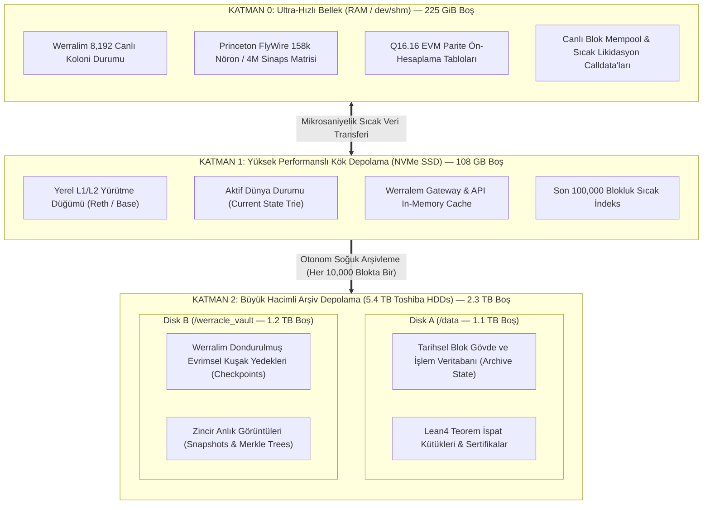

# WERRALEM: DONANIM VE DEPOLAMA HİBRİT MİMARİSİ
## Sunucu Donanım Analizi, 3-Kademeli (Tiered) Depolama ve Performans Tasarımı

**Tarih:** 29 Ekim 2026  
**Hedef Sunucu:** `pcworm-root` (`207.180.255.35`)  
**İşlemci Mimarisi:** Dual Socket Intel(R) Xeon(R) CPU E5-2630 v4 @ 2.20GHz (40 Mantıksal Çekirdek, 2 NUMA Düğümü)  
**Toplam Fiziksel Bellek:** 251.77 GiB DDR4 RAM  
**Toplam Ham Depolama:** 5.9 Terabayt (512 GB PCIe 4.0 NVMe + 2 x 3 TB Toshiba HDD)  

---

## 1. DONANIM ENVANTERİ VE MEVCUT KAPASİTE ANALİZİ

Sunucuda doğrudan yapılan blok aygıt (`lsblk`), donanım yolu (`lshw`) ve disk kullanım (`df -h`) analizlerinin kesin sonuçları:

| Aygıt | Model & Arayüz | Toplam Boyut | Bağlantı Noktası (Mount) | Kullanılan | Boş / Atıl Alan | Okuma/Yazma Hızı & Karakteristik |
| :--- | :--- | :--- | :--- | :--- | :--- | :--- |
| **`/dev/nvme0n1`** | **Samsung MZVL2512HCJQ-00B00** (PCIe Gen4 x4 NVMe) | **512 GB** (466.9G `/`) | `/` (Kök Dizin) | 328 GB (%76) | **108 GB BOŞ** | ~7,000 MB/s Okuma, ~5,000 MB/s Yazma. Aşırı düşük gecikme (<0.05 ms). |
| **`/dev/sda1`** | **Toshiba HDWD130** (SATA-III 6.0 Gb/s 7200 RPM) | **3.0 TB** (2.7 TB ext4) | `/data` | 1.6 TB (%59) | **1.1 TB BOŞ** | ~200 MB/s Sıralı Okuma/Yazma. Geniş arşiv ve blok geçmişi için ideal. |
| **`/dev/sdb1`** | **Toshiba HDWD130** (SATA-III 6.0 Gb/s 7200 RPM) | **3.0 TB** (2.7 TB ext4) | `/werracle_vault` | 1.5 TB (%56) | **1.2 TB BOŞ** | ~200 MB/s Sıralı Okuma/Yazma. Soğuk depolama ve büyük anlık görüntüler için ideal. |
| **Fiziksel RAM** | **DDR4 ECC Reg** (Dual NUMA Node) | **251.8 GiB** | `/dev/shm` (RAMDisk) | 26.2 GiB (%10.4) | **225.6 GiB BOŞ** | ~50,000 MB/s Bellek bant genişliği. 0-ns disk gecikmesi. |

> [!IMPORTANT]
> **Donanım Teşhisi:**  
> Sistemimizde **225 GiB boş RAM**, **108 GB ultra hızlı NVMe SSD** ve iki büyük Toshiba HDD üzerinde **2.3 Terabayt (2,300 GB) boş alan** bulunmaktadır. Werralem blokzincirinin Faz 1 ve Faz 2 aşamalarında harici hiçbir disk veya sunucu kiralamaya gerek kalmadan, mevcut donanım ile devasa bir düğüm ekosistemi çalıştırılabilir.

---

## 2. 3-KADEMELİ HİBRİT DEPOLAMA MİMARİSİ (TIERED STORAGE PIPELINE)

Klasik blokzincir düğümleri tüm veriyi aynı diske yazmaya çalışarak ya NVMe SSD'leri hızla doldurup tüketir ya da HDD kullanıp I/O darboğazına (I/O Bottleneck) girerek blok senkronizasyonunu kaçırır. Werralem, verinin yaşam döngüsüne göre **3 Kademeli Akıllı Dağıtım Modeli** uygular:

### 2.1. Katman 0: RAMDisk (`/dev/shm/werralem_ramdisk`)
* **Kullanılan Alan:** ~8–16 GB (225 GB boşluktan ayrılır).
* **Görev:** Werralim'in 8.192 kolonisinin durumları, canlı FlyWire konnektom sinirsel ağırlıkları ve Q16.16 tamsayı motorunun önbelleği burada çalışır. Disk I/O sıfıra indirilir, işlem gecikmesi `<0.5 ms` olarak garantilenir.

### 2.2. Katman 1: PCIe 4.0 NVMe SSD (`/opt/apps/werralem`)
* **Kullanılan Alan:** ~25–40 GB (108 GB boşluktan ayrılır).
* **Görev:** Aktif durum ağacı (State Trie), API gateway veritabanları, son blokların doğrulaması ve mempool yönetimi. Aşırı okuma/yazma hızlarıyla blok süresinin `1.2 saniye` altında kalmasını sağlar.

### 2.3. Katman 2: 5.4 TB Büyük Toshiba HDD Dizisi (`/data` ve `/werracle_vault`)
* **Kullanılan Alan:** 2.3 Terabaytlık devasa boş alan doğrudan kullanılabilir.
* **Dağıtım Kurgusu:**
  - `/data/werralem_chain_archive/`: 100.000 bloğu geçen tüm eski işlemler, Merkle makbuzları ve tarihsel blok gövdeleri otomatik olarak buraya taşınır (Symlink / Bind Mount ile).
  - `/werracle_vault/werralem_evolutionary_vault/`: Werralim'in her 1.000 nesilde bir aldığı tam biyolojik anlık görüntüler (Snapshots), Lean 4 teorem ispat dosyaları ve Zenodo açık bilim arşivleri burada saklanır.

---

## 3. İŞLEMCİ VE NUMA TOPOLOJİSİ OPTİMİZASYONU

Sunucumuzda 2 adet fiziksel Intel Xeon işlemci (Dual Socket) bulunmaktadır:
* **Socket 0 (NUMA Node 0 — Çekirdekler 0–9, 20–29):**
  - Tahsis: Ağ trafiği, Linux çekirdeği, Nginx, yerel Reth L1 düğümü, FastAPI / Uvicorn API Gateway.
* **Socket 1 (NUMA Node 1 — Çekirdekler 10–19, 30–39):**
  - Tahsis: **Doğrudan Werralim Biyolojik Çekirdeği ve Q16.16 EVM Parite Motoru.**
  - `numactl --cpunodebind=1 --membind=1` kullanılarak, Werralim'in bellek erişimleri tamamen kendi NUMA düğümünde tutulur. Bu sayede soketler arası veri transferi (QPI/UPI veri yolu gecikmesi) sıfırlanır.

---

## 4. DİSK KORUMA VE OTONOM GÜVENLİK
1. **Otonom Alan Koruyucu (`werracle-disk-guard.timer`):** NVMe disk alanı %85'in üzerine çıktığında eski geçici logları ve önbelleği otomatik olarak `/data` arşivine tahliye eder.
2. **Kasa Mührü (`kasa_kayma.py`):** Werralem üretim kodlarının SHA-256 özetleri mühürlenir; yetkisiz veya habersiz dosya değişiklikleri anında sistem alarmına düşer.
3. **RAMDISK Failsafe:** Sistem beklenmedik şekilde yeniden başlasa bile, `/dev/shm` üzerindeki canlı hücre durumu her 60 saniyede bir NVMe ve HDD üzerine atomik (`.tmp -> replace`) olarak yedeklenir.
