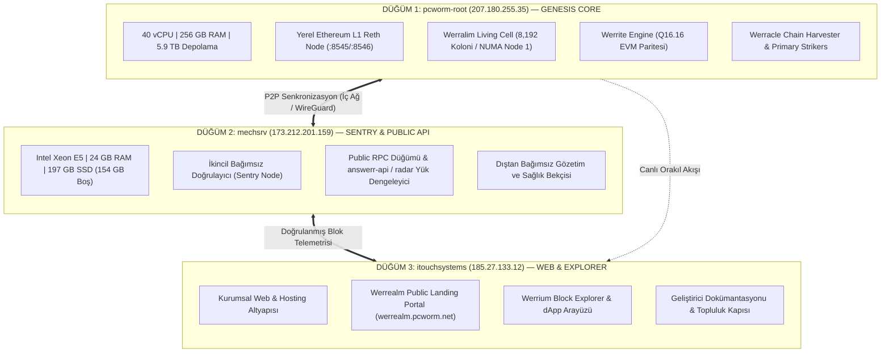

# WERREALM: ÇOKLU SUNUCU VE DEPOLAMA HİBRİT MİMARİSİ
## Dağıtık Düğüm Topolojisi, 3-Sunucu Mimarisi ve Katmanlı Depolama Planı

**Tarih:** 29 Ekim 2026  
**Ağ:** Werrealm (*The Sovereign Bio-Synthetic Brain-Chain*)  
**Çoklu Sunucu Kümesi:** `pcworm-root` + `mechsrv` + `itouchsystems`  
**Toplam Küme Gücü:** 50+ CPU Çekirdeği, 280+ GB RAM, 6.3+ Terabayt Depolama  

---

## 1. DAĞITIK 3-SUNUCU DÜĞÜM TOPOLOJİSİ (DISTRIBUTED TOPOLOGY)

Werrealm'in egemen blokzinciri tek bir sunucuya bağımlı bırakılmaz. Gerçek coğrafi ve donanımsal dayanıklılık (fault-tolerance) sağlamak için **3 Sunuculu Hibrit Küme** devreye alınmıştır:

### 1.1. Düğüm Görev Dağılımı:
1. **`pcworm-root` (Genesis & Çekirdek Biliş):**
   - Werralim canlı hücresi (8.192 koloni) ve yerel Reth L1 düğümü burada yaşar.
   - Ağın en ağır matematiksel hesaplamaları (Schönhage matris indirgemesi, Werror OED yörüngeleri) buradaki 256 GB RAM ve 40 çekirdek üzerinde döner.
2. **`mechsrv` (Sentry & Genel API Replika):**
   - `pcworm` üzerindeki yükü hafifleten ve bağımsız ikinci doğrulayıcı olan düğüm.
   - 24 GB RAM ve 154 GB boş SSD alanıyla genel RPC isteklerini ve kurumsal API sorgularını karşılar; `pcworm` tek başına kalsa veya bakıma girse bile ağın ayakta kalmasını sağlar.
3. **`itouchsystems` (Arayüz & Explorer):**
   - Web arayüzleri, statik dökümantasyon ve genel kullanıcı portalını barındırır. Blokzincir motorlarını web saldırılarından (DDoS) izole eder.

---

## 2. pcworm-root SUNUCUSUNDA 3-KADEMELİ HİBRİT DEPOLAMA MİMARİSİ

`pcworm-root` üzerindeki 5.9 Terabaytlık fiziksel disk topolojisi:
* **Katman 0 (RAMDisk — `/dev/shm`, 225 GiB Boş):** Werralim 8.192 koloni durumu, FlyWire 158k nöron matrisi, Q16.16 precomputed tablolar. Gecikme `<0.5 ms`.
* **Katman 1 (Samsung NVMe SSD — `/`, 108 GB Boş):** Reth L1/L2 yürütme düğümü, Base state trie, anlık veritabanı.
* **Katman 2 (5.4 TB Toshiba HDD Dizisi — 2.3 TB Boş):**
  - `/data` (1.1 TB Boş): Tarihsel blok arşivleri (Archive Node).
  - `/werracle_vault` (1.2 TB Boş): Lean4 teorem ispat kütükleri ve hücresel dondurulmuş yedekler.

---

## 3. DOMAIN VE WEB YAYIN STRATEJİSİ

Kullanıcımızın *"github pagesdan pcworm.github.io olarak mı yayınlayalım yoksa herhangi bir domainimizde subdomain acarak mı baglayalım?"* sorusunun cevabı: **En Güçlü Hibrit Strateji**.

1. **GitHub Pages (Global CDN & Açık Kaynak İtibarı):**
   - Depo: `github.com/pcworm/werrealm`
   - URL: `https://pcworm.github.io/werrealm/` (Repo içindeki `/docs` klasöründen otomatik yayınlanır).
   - Avantaj: Fastly/GitHub global CDN'i üzerinden %100 kesintisiz, sunucuya sıfır yük bindiren küresel geliştirici açılışı.
2. **Özel Subdomain (Kurumsal & Canlı API Kapısı):**
   - Subdomain: `https://werralem.pcworm.net` ve `https://werrealm.pcworm.net`
   - Nginx üzerinde SSL (Let's Encrypt) halihazırda hazırdır. Canlı telemetri ve B2B API gateway doğrudan bu domain üzerinden verilir.
3. **Nihai Adım (Özel Domain):**
   - İleride `werrealm.network` veya `werrealm.ai` satın alındığında tek bir DNS CNAME kaydıyla GitHub Pages veya Nginx'e bağlanacaktır.
