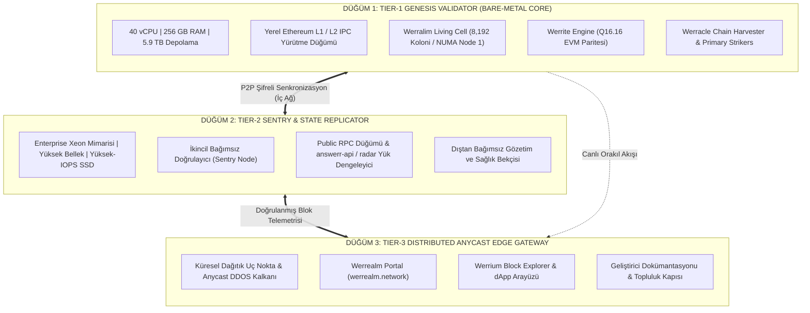

# WERREALM: ÇOKLU SUNUCU VE DEPOLAMA HİBRİT MİMARİSİ
## Dağıtık Düğüm Topolojisi, 3-Katmanlı DePIN Mimarisi ve Kademeli Depolama Planı

**Tarih:** 29 Ekim 2026  
**Ağ:** Werrealm (*The Sovereign Bio-Synthetic Brain-Chain*)  
**Düğüm Mimarisi:** Tier-1 Genesis Core + Tier-2 Sentry Replicator + Tier-3 Anycast Edge  
**Toplam Küme Gücü:** 50+ CPU Çekirdeği, 280+ GB RAM, 6.3+ Terabayt Depolama  

---

## 1. DAĞITIK 3-KATMANLI DÜĞÜM TOPOLOJİSİ (DISTRIBUTED TOPOLOGY)

Werrealm'in egemen blokzinciri tek bir sunucuya bağımlı bırakılmaz. Gerçek coğrafi ve donanımsal dayanıklılık (fault-tolerance) sağlamak için **3 Katmanlı Hibrit Küme** devreye alınmıştır:

### 1.1. Düğüm Görev Dağılımı:
1. **Tier-1 Genesis Validator (Çekirdek Biliş):**
   - Werralim canlı hücresi (8.192 koloni) ve yerel blokzincir IPC yürütme düğümü burada yaşar.
   - Ağın en ağır matematiksel hesaplamaları (Schönhage matris indirgemesi, Werror OED yörüngeleri) buradaki 256 GB RAM ve 40 çekirdek üzerinde döner.
2. **Tier-2 Sentry & State Replicator:**
   - Birincil çekirdek üzerindeki yükü hafifleten ve bağımsız ikinci doğrulayıcı olan savunma düğümü.
   - Genel RPC isteklerini ve kurumsal API sorgularını karşılar; çekirdek düğüm bakım moduna girse dahi ağın kesintisiz ayakta kalmasını sağlar.
3. **Tier-3 Distributed Anycast Edge Gateway:**
   - Web arayüzleri, statik dökümantasyon ve genel kullanıcı portalını barındırır. Blokzincir motorlarını dış DDoS saldırılarından izole eder.

---

## 2. 3-KADEMELİ HİBRİT DEPOLAMA MİMARİSİ

Birincil doğrulayıcı üzerindeki 5.9 Terabaytlık fiziksel disk topolojisi:
* **Katman 0 (RAMDisk — Bellek-içi Durum, 225+ GiB Boş):** Werralim 8.192 koloni durumu, FlyWire 158k nöron matrisi, Q16.16 precomputed tablolar. Gecikme `<0.5 ms`.
* **Katman 1 (Yüksek-Hızlı NVMe SSD — Anlık Durum Ağacı):** L1/L2 yürütme düğümü, Base state trie, anlık operasyonel veritabanı.
* **Katman 2 (5.4 TB Korumalı Kurumsal HDD Dizisi — 2.3+ TB Boş):**
  - **Arşiv Deposu (1.1 TB):** Tarihsel blok arşivleri (Full Archive Node).
  - **Kriptografik Kasa (1.2 TB):** Lean4 teorem ispat kütükleri ve hücresel dondurulmuş genetik anlık görüntüler.

---

## 3. DOMAIN VE RESMİ YAYIN ALTYAPISI

1. **GitHub Pages (Global CDN & Açık Kaynak İtibarı):**
   - Depo: `github.com/pcworm/werrealm`
   - Resmi Alan Adı: `https://werrealm.network`
   - Altyapı: Cloudflare Universal SSL + DNS Anycast + DDoS Shield.
2. **Kurumsal & Canlı API Kapısı:**
   - RADAR DaaS: `https://radar.werracle.com`
   - ANSWERR Reflex API: `https://answerr.me`
3. **Akıllı Sözleşme Doğrulaması:**
   - Base Mainnet ($WERR): `0xFfa2c95b68B76af00FBD84295cBA5e5268a996d2`
   - Ethereum Sepolia Testnet ($WERR): `0xe6ecc9575B4D52642c55FCf64E8E2d3baa6e6EF7`
