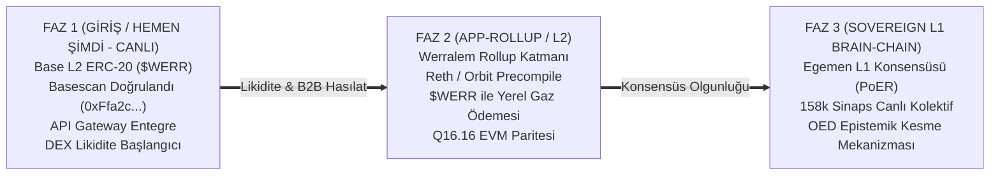

# WERREALM: KANONİK 3-FAZLI YOL HARİTASI VE GELİŞİM PLANI
**Ağ:** Werrealm (*The Sovereign Bio-Synthetic Brain-Chain*)  
**Yerel Varlık:** Werrium ($WERR) — 1,000,000,000 Sabit Arz  
**Tarih:** 29 Ekim 2026  

---

## 1. STRATEJİK FAZ MİMARİSİ

### FAZ 1: Giriş / Hemen Şimdi (TAMAMLANDI & CANLIDA)
* **Ağ:** Base Layer-2 Mainnet (Chain ID: `8453`)
* **Sözleşme Adresi:** `0xFfa2c95b68B76af00FBD84295cBA5e5268a996d2`
* **Arz ve Mülkiyet:** 1,000,000,000 $WERR (Sabit arz, kurucu MetaMask cüzdanına teslim edildi).
* **Entegrasyonlar:**
  * `radar.werracle.com` kurumsal veri akışında `$WERR` stake kapısı aktif.
  * `answerr.me` yapay zeka refleks API'sinde karar yakım (`burnForReflex`) başlıkları entegre.
  * `werrealm.network` ana portalı, tokenomik ve DePIN mimari sayfalarıyla canlıda.
* **Sıradaki Adım:** Aerodrome Finance ve Uniswap v3 havuzlarında likidite eşlemesi (`WERR/ETH` ve `WERR/USDC`).

---

### FAZ 2: Werralem App-Rollup / L2 (PLANLANDI)
* **Kapsam:** Yerel Reth ve Arbitrum Orbit / OP-Stack mimarisi üzerinde, Werr motorunun EVM içine yerel ön-derlenmiş sözleşme (precompile) olarak gömüldüğü ve gaz ücretinin doğrudan $WERR olduğu katman.
* **Teknik Bileşenler:**
  * Werror Engine (OED yörünge dinamikleri) ve Werrite Engine (Q16.16 sabit nokta matematiği) precompile olarak rust seviyesinde EVM'e entegre edilir.
  * İşlem gazı doğrudan $WERR cinsinden ödenir; blok üreticileri ağ güvenliğini $WERR stake ederek sağlar.
  * Base L1/L2 ile çift yönlü yerel köprü (canonical bridge) tesis edilir.

---

### FAZ 3: Sovereign L1 Brain-Chain (NİHAİ EGEMENLİK)
* **Kapsam:** Ağ olgunlaştığında kendi bağımsız mutabakatına (**PoER - Proof of Epistemic Resonance**) geçen egemen kolektif beyin zinciri.
* **Teknik Bileşenler:**
  * 158.262 Werron sinapsı (FlyWire) ve 8.192 koloni canlı hücresi doğrudan L1 durum geçiş fonksiyonunu oluşturur.
  * GPU bağımlılığı olmadan heterojen doğrulayıcı düğümler arasında sıfır kayma ile konsensüs sağlanır.
  * Epistemik Kesme (Slashing): Hatalı veya yozlaşmış blok öneren düğümler fraktal kaos sınırında otomatik olarak tasfiye edilir.

---

## 2. GÜVENLİK VE İZOLASYON PRENSİPLERİ
* Özel IP adresleri, iç sunucu ana makine isimleri ve sistem şifreleri kamuya açık dokümanlara kesinlikle yansıtılmaz.
* Tüm donanım kümesi "Tier-1 Genesis Core", "Tier-2 Sentry Replicator" ve "Tier-3 Anycast Edge" kurumsal DePIN tanımlamalarıyla anılır.
