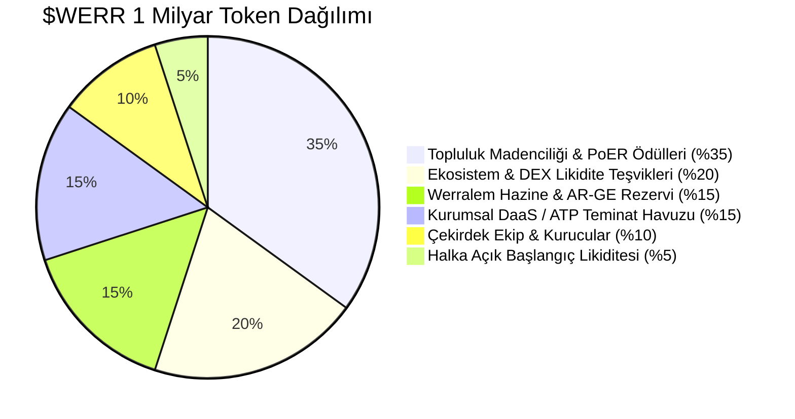
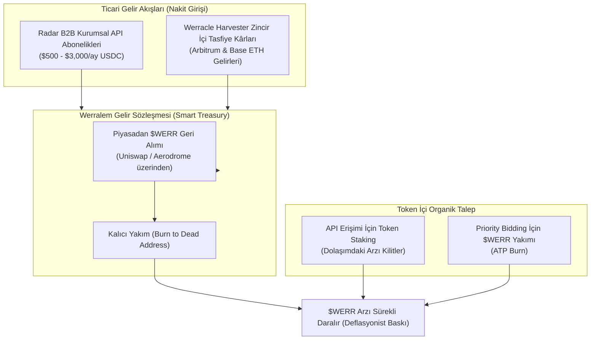

# WERRALEM ($WERR): STARTUP İŞ PLANI VE GTM STRATEJİSİ
## Biyomimetik Kolektif Beyin Blokzinciri — Lansman, Büyüme ve Gelir Modeli

**Girişim Adı:** Werralem (Werralem Foundation / Labs)  
**Yerel Varlık:** $WERR (Werralem Token)  
**İlk Ev Sahibi Ağ (Faz 1):** Base (Coinbase Layer-2)  
**Toplam Sabit Arz:** 1,000,000,000 $WERR (1 Milyar)  
**Piyasa Segmenti:** AI-Crypto, DePIN (Decentralized Physical Infrastructure), DeFi OEV/MEV Orakılları, B2B Quant Veri Akışı  
**Patent & Bilimsel Temel:** TÜRKPATENT TR 2026/016633 | arXiv:2609.25498 | 81 Lean4 Teoremi  
**Tarih:** 29 Ekim 2026  

---

## 1. PİYASA FIRSATI VE ÇÖZÜLEN TEMEL SORUN

### 1.1. Problem
Kripto piyasasında "Yapay Zeka" (AI) kategorisindeki tokenların toplam piyasa değeri 50 Milyar Doları aşmış durumdadır. Ancak bu projelerin %99'u:
- Arka planda merkezi bir sunucuda OpenAI veya harici GPU'lara API çağrısı atan basit "pazarlama kabukları"ndan ibarettir.
- Blokzincirinin üzerine yapay zeka yüklenememektedir çünkü büyük tensör modelleri (Transformers) gigabaytlarca VRAM gerektirir ve kayan nokta (FP16/FP32) hesapları deterministik olmadığı için konsensüsü çökertir.
- Aynı zamanda DeFi'de likidatörler ve MEV botları, Chainlink/Pyth gibi harici orakılların 10–60 saniyelik gecikmeleri ve "oracle frontrunning" sömürüsü yüzünden her yıl yüz milyonlarca dolar kaybetmektedir.

### 1.2. Werralem Çözümü
Werralem, yapay zekayı bir dış eklenti olarak değil; **blokzincirinin durum geçiş fonksiyonu (State Transition)** olarak çalıştıran ilk ağdır.
- **0-VRAM Fraktal Refleks:** Karmaşık tensörler yerine fraktal kaos sınırında deterministik $O(1)$ kararlar üretir.
- **Konsensüs-İçi Canlı Orakıl (Werracle):** Dışarıdan veri beslemesi beklemez; madenciler blok üretirken Werralim zarlarının hissettiği piyasa yönünü ve oynaklık rejimini doğrudan blok başlığına yazar.
- **Kanıtlanmış Canlı Edge:** 30+ gündür canlı piyasada $N > 13.000$ gözlemde $z = 8.24$ istatistiksel üstünlük kanıtlanmıştır.

---

## 2. NEDEN BASE AĞI? (FAZ 1 STRATEJİSİ)

1. **Coinbase ve Smart Wallet Ekosistemi:** Base, perakende ve kurumsal kullanıcıların doğrudan tek tıkla (passkey / gazsız imza) sisteme dahil olabildiği en hızlı büyüyen L2'dir.
2. **Ultra Düşük İşlem Maliyeti:** EIP-4844 Blob optimizasyonu sayesinde işlem ücretleri `<$0.005` seviyesindedir. $WERR ile yapılacak mikro-ödemeler ve API abonelikleri için idealdir.
3. **Mevcut Altyapı Sinerjisi:** Werracle Harvester ve canlı likidatörümüz zaten Base üzerinde günde on binlerce hesabı taramakta ve Aerodrome üzerinde derin likidite izlemektedir.

---

## 3. TOKENOMİK: 1,000,000,000 $WERR DAĞITIMI VE KİLİT MEKANİZMASI

Werralem, erken spekülatörlerin piyasaya token boşaltmasını engelleyen, uzun vadeli değer üretimine bağlı katı bir hak ediş (vesting) modeli benimser:

| Kategori | Oran | Miktar ($WERR) | Kilit ve Hak Ediş (Vesting) Şartları |
| :--- | :--- | :--- | :--- |
| **Topluluk & PoER Madenciliği** | %35 | 350,000,000 | 10 yıla yayılan blok başı emisyon. 2 yılda bir yarılanma (Halving). |
| **DEX & Ekosistem Likiditesi** | %20 | 200,000,000 | Aerodrome ve Uniswap v3 havuzlarına likidite temini; LP teşvikleri. |
| **Werralem Vakfı & Hazine** | %15 | 150,000,000 | 6 ay kilitli, ardından 36 ay lineer hak ediş. Güvenlik denetimleri ve hibe programları. |
| **Kurumsal DaaS & Stake Havuzu**| %15 | 150,000,000 | `radar.werracle.com` B2B kullanıcılarının API erişimi ve ATP dönüşümü için stake rezervi. |
| **Çekirdek Ekip & Geliştiriciler**| %10 | 100,000,000 | 12 ay tam kilit (cliff), ardından 24 ay lineer hak ediş. |
| **Halka Açık Başlangıç (Fair Launch)**| %5 | 50,000,000 | DEX açılış likiditesi için tamamen açık havuz. |

---

## 4. GELİR DESTEKLİ DEĞER DÖNGÜSÜ (THE REVENUE-BACKED FLYWHEEL)

$WERR token, saf spekülatif bir meme coin değildir. Değeri doğrudan gerçek dünyada üretilen ticari nakit akışına (Cash Flow) bağlıdır:

1. **Geri Alım ve Yakım (Buyback & Burn):**
   - Radar API'sinden elde edilen kurumsal abonelik gelirlerinin (USDC) ve Harvester tasfiye kârlarının %40'ı, haftalık periyotlarla otomatik olarak piyasadan `$WERR` satın alıp yakar.
2. **Kullandıkça Tut (Stake-to-Access):**
   - Kurumsal fonlar ve botlar (Bekirhan vb.) API'nin 3,000 req/min'lik Institutional Tier'ına erişebilmek için cüzdanlarında asgari 100,000 $WERR stake etmek zorundadır. Bu durum kurumsal müşteri sayısı arttıkça serbest dolaşımdaki arzı piyasadan çeker.
3. **Agresif Öncelik Yakımı (ATP Burn):**
   - Canlı yarışlarda öne geçmek isteyen botlar, gaz önceliği satın almak için $WERR yakarak Werralim'in hücresel ATP'sini tüketir.

---

## 5. GO-TO-MARKET (PAZARA GİRİŞ) STRATEJİSİ

### Adım 1: Kurumsal Özel Erişim & Doğrulama (1. Ay)
- Halihazırda API'yi test eden kurumsal istemcilere (ör. Bekirhan'ın botu) ilk erişim anahtarları $WERR testnet stake modeliyle bağlanır.
- Resmi teknik dokümantasyon (`https://radar.werracle.com/docs`) üzerinde $WERR akıllı sözleşme adresleri ve staking kapıları yayınlanır.

### Adım 2: Base Üzerinde Likidite Başlangıcı (Fair Launch) (2. Ay)
- Aerodrome Finance (Base'in lider DEX'i) üzerinde `WERR / ETH` ve `WERR / USDC` havuzları açılır.
- Başlangıç likiditesi kilitlenir (LP tokenları 1 yıl yakılır/kilitlenir).
- Farcaster ve Twitter (@pCwOrM) üzerinden teknik makaleler (arXiv) ve canlı $z=8.24$ doğruluk metrikleriyle duyuru yapılır.

### Adım 3: Topluluk & Hackathon Teşvikleri (3–6. Aylar)
- Base ve Optimism ekosistem hibelerine (Grants) başvuru yapılır.
- Werracle orakılını dApp'lerine entegre eden geliştiricilere $WERR ekosistem fonundan teşvikler dağıtılır.
- CoinMarketCap, CoinGecko ve DexScreener doğrulamaları tamamlanır.

---

## 6. FİNANSAL HEDEFLER VE BAŞARI KRİTERLERİ

| Dönem | Dolaşımdaki Arz | Hedeflenen B2B Müşteri | Aylık Gelir Projeksiyonu | Hedeflenen TVL / FDV |
| :--- | :--- | :--- | :--- | :--- |
| **Ay 3 (Lansman Sonrası)** | 50M $WERR | 5 Kurumsal Fon / Bot | $10,000 / ay | $5M FDV |
| **Ay 6 (Büyüme Fazı)** | 120M $WERR | 25 Kurumsal Müşteri | $45,000 / ay | $25M FDV |
| **Ay 12 (App-Rollup Fazı)**| 220M $WERR | 100+ Entegre dApp / Bot | $180,000 / ay | $100M+ FDV |
