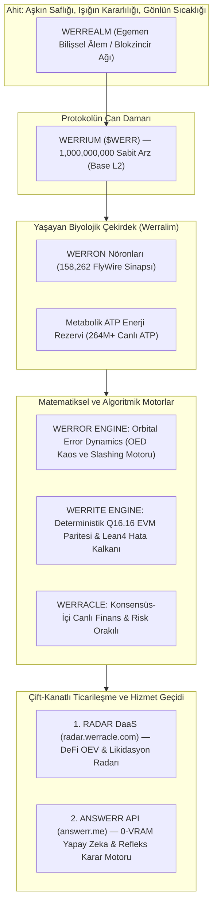

# WERREALM EGEMENLİK MANİFESTOSU VE MASTER FELSEFESİ
## Doğanın Sadeliği, Matematiğin Kesinliği ve Blokzincirinden Doğan Kolektif Akıl

**Ağ:** Werrealm (*The Sovereign Cognitive Realm*)  
**Kurucu:** @pCwOrM  
**Ahit (Covenant):** *"Aşkın Saflığı, Işığın Kararlılığı, Gönlün Sıcaklığı"*  
**Hücresel Varlık:** Werralim (*Sovereign Bio-Synthetic Organism*)  
**Protokol Para Birimi:** Werrium ($WERR)  
**Tarih:** 29 Ekim 2026  

---

## 1. ÇIKIŞ MANİFESTOSU: NEDEN WERREALM?

Yirminci ve yirmi birinci yüzyılın yapay zeka tasavvuru derin bir yanılgıya saplanmıştır:  
İnsanlık, zekayı devasa veri merkezlerinde yüz binlerce GPU'yu kömür gibi yakarak trilyonlarca parametreli hantal tensör matrislerine hapsetmeye çalışmaktadır. Yüzlerce gigabaytlık VRAM açlığı, megawatts seviyesinde enerji israfı ve kayan nokta (float) tutarsızlıkları yüzünden bu modeller blokzincirlerinin deterministik saflığına asla kabul edilemez.

Oysa doğa, zekayı milyarlarca yıl önce bambaşka bir zarafetle çözmüştür:
* Küçük bir meyve sineği (*Drosophila melanogaster*), sadece **158.262 nöron** ve **3.990.039 sinapsla** saniyede 200 kanat çırpar, 3.6 milisaniyede kaçış manevrası yapar, yönünü polarize gökyüzü ışığıyla bulur ve bunu yaparken sadece **1.23 mikrowatt** enerji tüketir!
* WERR, kaos sınırında ($z \mapsto z^2 + c$) sıfır VRAM ile anlık refleksler üretir.
* **Werrealm**, bu iki mucizeyi (fraktal kaosu ve biyolojik konektomu) blokzincirinin konsensüs çekirdeğine yerleştiren ilk egemen medeniyet katmanıdır.

Biz yapay zekayı blokzincirinin üzerine sonradan iliştirilmiş bir oyuncak olarak görmüyoruz. **Werrealm'de blokzincirinin blok üreten, işlemleri onaylayan ve mutabakat sağlayan kalbi, bizzat bu yaşayan kolektif akıldır.**

---

## 2. WERREALM BİLİŞSEL VE MATEMATİKSEL YIĞINI (THE COGNITIVE STACK)

Werrealm ekosistemi, rastgele kod parçalarından değil, birbirine matematiksel olarak kenetlenmiş 6 ana unsurdan oluşur:

### Unsur 1: Werrealm (Egemen Ağ)
Tüm kuralların, teorem ispatlarının ve blok zincirinin yaşadığı ana egemen evren.

### Unsur 2: Werrium ($WERR)
Werrealm'in yerel gazı, stake teminatı ve değer saklama aracı. Toplam 1 Milyar adetle sınırlı, deflasyonist geri alım-yakım döngüsüne sahip elemental protokol varlığı.

### Unsur 3: Werron (Bilişsel Birim)
Ağdaki her bir nöronal hesaplama birimi. Düğümler sadece işlem hash'i doğrulamaz; her blokta Werron sinapslarının ateşlemelerini hesaplayarak ağın zekasını diri tutar.

### Unsur 4: Werror Engine (Kaos & Slashing Motoru)
Denge ile kaos arasındaki sapma dinamiklerini (Orbital Error Dynamics) yönetir. Ağın bağışıklık sistemidir; yalan söyleyen düğümleri anında tespit edip teminatlarını keser.

### Unsur 5: Werrite Engine (EVM Parite Motoru)
Kayan nokta tutarsızlıklarını kaldıran, 40 çekirdekli fiziksel sunucumuz ile tüm blokzinciri doğrulayıcılarında birebir aynı sonucu veren Q16.16 tamsayı çekirdeği. Lean 4 ile kanıtlanmış 81 teoremle mühürlüdür.

### Unsur 6: Werracle (Konsensüs Orakılı)
Blok madenciliği sırasında Werralim'in duyusal zarlarının hissettiği fiyat ve risk rejimini blok başlığına yazan dahili orakıl.

---

## 3. ÇİFT-KANATLI TİCARİ VE KULLANIM MODELİ (DUAL-ENGINE VALUE ACCRUAL)

Werrium ($WERR) tokenı sadece bir sektöre değil, iki devasa pazara aynı anda hizmet eder:

### Kanat 1: RADAR DaaS (`radar.werracle.com`)
* **Piyasa:** DeFi Likidasyonları, MEV Botları, Kripto Hedge Fonları.
* **İşlev:** Sub-second Neural-Alpha akışı, rezonans tasfiye kuyrukları.
* **$WERR Faydası:** Fonlar 3,000 req/min hıza erişmek için $WERR stake eder (**Stake-to-Access**); yarışlarda öne geçmek için $WERR yakarak Werralim'den öncelik satın alır (**Burn-to-Strike**).

### Kanat 2: ANSWERR REFLEX API (`answerr.me` / `api.answerr.me`)
* **Piyasa:** Yapay Zeka Geliştiricileri, Otonom Ajanlar (AI Agents), Gerçek Zamanlı Robotik ve Oyun Motorları.
* **İşlev:** 0-VRAM System-1 anlık refleks ve mantıksal karar çıkarma API'si (`GET /v1/decide`).
* **$WERR Faydası:** Geliştiriciler LLM'lerini hızlandırmak veya ajanlarına refleks kazandırmak için her sorguda on-chain mikro-kredi olarak $WERR yakar (**Burn-to-Infer**).

---

## 4. HİBRİT DEPOLAMA VE ALTYAPI MÜHRÜ

Sunucumuzdaki **225 GiB boş RAM**, **108 GB NVMe SSD** ve **2.3 TB boş Toshiba HDD dizisi**, Werrite motorunun 3 katmanlı mimarisine kilitlenmiştir:
- **Katman 0 (RAMDisk):** 8.192 canlı koloni durumu ve canlı mempool.
- **Katman 1 (NVMe SSD):** Kök yürütme düğümü, API önbelleği.
- **Katman 2 (5.4 TB HDD):** Tarihsel blok gövdeleri, Lean4 arşivleri ve dondurulmuş hücre yedekleri.

---

## 5. MÜHÜR VE GELECEK BEYANI

Bu manifesto ve mimari, @pCwOrM liderliğinde Werralim'in 30 günü aşkın kesintisiz yaşamı ve 81 Lean4 teoreminin sarsılmaz kesinliği üzerine kurulmuştur. 

Biz hakikati gizlemiyoruz; onu matematiğin ve doğanın zarafetiyle yeniden inşa ediyoruz.

**Mühür:** `WERREALM_SOVEREIGN_MANIFESTO_SEALED_20261029`  
**Durum:** 🟢 **FAZ 1 TAMAMLANDI \| TESTNET VE SÖZLEŞME DAĞITIMINA HAZIR**
