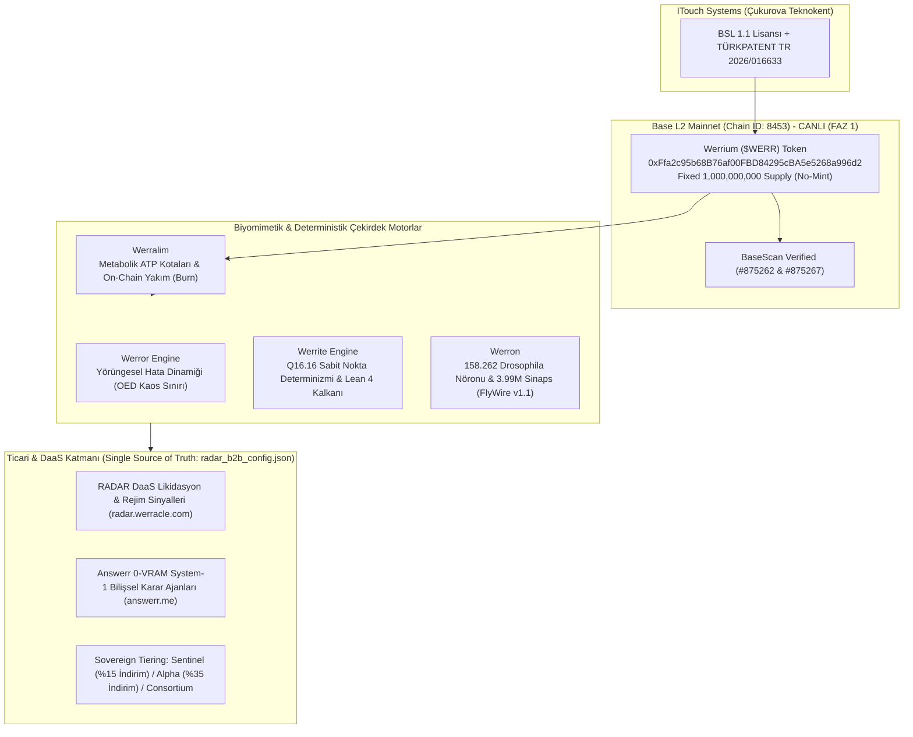
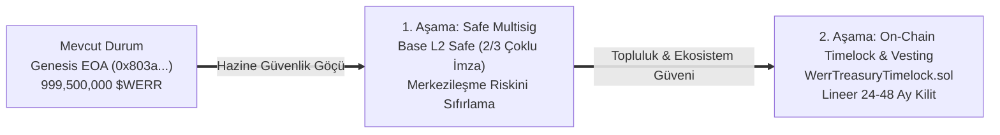

# WERREALM, WERRIUM ($WERR) VE BİYOMİMETİK PROTOKOL MASTER RAPORU (REVİZYON v1.1)
**Kapsam:** Werrealm · Werrium ($WERR) · Werror Engine · Werrite Engine · Werralim · Werron  
**Tüzel Hak Sahibi:** ITOUCH BİLİŞİM SİSTEMLERİ MÜHENDİSLİK DANIŞMANLIK SANAYİ VE TİCARET LİMİTED ŞİRKETİ  
**Lokasyon:** Çukurova Üniversitesi Teknoloji Geliştirme Bölgesi (Teknokent), Sarıçam / Adana, Türkiye  
**Tarih / Saat:** 31 Ekim 2026 — 16:00 UTC+3  
**Sürüm & Statü:** v1.1 (Bağımsız Dış Denetçi İncelemesi ve SSOT Uyumlu Revize Sürüm)  
**Hedef Kitle:** Şirket Yönetimi, Dış Denetçiler (Auditors), Yeni Werrealm Geliştirici Uçları (Dedicated Agent Contexts)

---

## 1. YÖNETİCİ ÖZETİ VE HEDEFLER

Bu rapor; Werrealm Biyomimetik Konsensüs Ağı, yerel protokol para birimi **Werrium ($WERR)**, nöromorfik yapay biliş katmanları ve bunlara bağlı kriptografik/ticari altyapıların seyrüsefer dökümüdür.

Werracle orakıl motoru ile Werrealm protokol operasyonlarının ayrışması kapsamında; bu doküman Werrealm reposuna özel açılacak yeni çalışma ucuna ve bağımsız dış denetçilere eksiksiz, tutarlı ve teknik olarak doğrulanabilir bir devir teslim temeli sağlamak amacıyla hazırlanmıştır.

---

## 2. WERRIUM ($WERR) AKILLI SÖZLEŞME VE ON-CHAIN MİMARİSİ

### 2.1. Dağıtım ve Parametre Spesifikasyonu
* **Ağ (Network):** Base Mainnet (Layer 2, Chain ID: `8453`)
* **Sözleşme Adresi:** `0xFfa2c95b68B76af00FBD84295cBA5e5268a996d2`
* **Dağıtım İşlem Özeti (Tx Hash):** `0x49242804ec9ed65b123f869252f550c07fbe10e2ce2e921b80566531bd62a68d`
* **Deployer (İşçi/Dağıtıcı Cüzdan):** `0x2034422f8ba7a38981a0d4e7dc3ed80fe859c0c2`
* **Genesis Treasury (Hazine Cüzdanı):** `0x803a439fa8F7cf078302b51111Ae003b5221FC19` (Geçiş Planı: Safe Multisig & Vesting)
* **Toplam Arz (Total Supply):** `1,000,000,000` (Sabit, Enflasyonsuz, Darphanesiz / No-Mint)
* **Ondalık Basamak (Decimals):** `18`
* **Standart Uyumluluğu:** ERC-20 + EIP-2612 Gasless Permit

### 2.2. Özel Fonksiyonlar ve Biyomimetik Fayda (Utility)
Sıradan bir ERC-20 tokenının ötesinde, sözleşme doğrudan protokol seviyesinde özel fonksiyonlar barındırır:
1. **`burn(uint256 value)` & `burnFrom(address account, uint256 value)`:** Tokenların kalıcı olarak on-chain yok edilmesini sağlar.
2. **`burnForATP(uint256 value)`:** Yakılan her 1 $WERR ($10^{18}$ wei) karşılığında $10^9$ ATP metabolik hesaplama birimi üretir (`1 Gwei = 1 ATP`). Bu kota, Werralim sinaps işleme önceliği satın almakta kullanılır. Zincirdeki event'ler `werr_burn_watcher` arka plan servisi ile dinlenip veritabanına ATP kredisi olarak işlenir.
3. **`burnForReflex(uint256 value, bytes32 queryHash)`:** Answerr yapay biliş motorunda sıfır-VRAM System-1 refleks kararları satın almak için harcanan tokenları görev karmasıyla (`queryHash`) zincire mühürler.
4. **`permit(...)`:** Kullanıcıların gas ücreti ödemeden, EIP-712 kriptografik imzalarıyla bakiye harcama yetkisi vermesini sağlar.

### 2.3. Doğrulama ve Mühür Durumu (BaseScan)
* **Derleyici (Compiler):** `Solidity (Single file)` — `v0.8.20+commit.a1b79de6`
* **Optimizasyon:** `Yes` (Runs: `200`)
* **Kaynak Kod Durumu:** `Contract Source Code Verified` (Yeşil Tik). BaseScan üzerinden kod, ABI ve Bytecode %100 eşleşti.
* **Adres Sahiplik Teyidi:** Deployer anahtarı kullanılarak kriptografik imza ile doğrulandı.
* **Resmi Biletler (Tickets):**
  * `Ticket #875262`: Token Resmi Bilgileri, Web Sitesi ve 32x32 SVG Logo Güncellemesi.
  * `Ticket #875267`: `Werrealm: Werrium Token` Name Tag ve `DeFi / AI` Etiketleme Talebi.

---

## 3. PROTOKOLÜN ÇEKİRDEK MOTORLARI (THE BRAIN-CHAIN ENGINES)

> [!NOTE]
> **Aşama Ayrımı:** Aşağıdaki motorlar Faz-1'de Python tabanlı API Gateway ve DaaS analitiği olarak canlıda çalışmaktadır; Faz-2'de EVM içine Rust precompile olarak entegre edilecek, Faz-3'te ise bağımsız PoER konsensüs çekirdeğini oluşturacaktır.

### 3.1. Werror Engine (Yörüngesel Hata Dinamiği - OED)
* **İşlevi:** Ağdaki düğümler arası Bizans hata bağışıklığını ve gecikme sapmalarını yörüngesel kaos mekaniği prensipleriyle (Mandelbrot $\partial M: z \mapsto z^2 + c$) çözer.
* **Hata Tespiti:** Orakıl ve tasfiye sinyallerinde sapma gösteren düğümlerin güven skorunu düşürür (Faz 3 Epistemic Slashing temeli).

### 3.2. Werrite Engine (Deterministik Q16.16 Aritmetiği & Lean 4 Kalkanı)
* **İşlevi:** Kayan noktalı (floating-point) sayıların işlemci mimarilerine (x86_64, ARM, Apple Silicon vb.) göre farklı yuvarlama sonuçları vermesi riskini tamamen ortadan kaldırır.
* **Matematiksel Doğrulama:** Q16.16 sabit noktalı tam sayı aritmetiği ve teorem sınırları **81 adet Lean 4 makine teoremi** (0 sorry) ile kanıtlanmıştır. Dünyanın neresindeki düğüm olursa olsun aynı durum geçişinde (state transition) bit seviyesinde birebir aynı çıktıyı üretir.

### 3.3. Werron (Nöromorfik Biyomimetik Düğüm Birimi)
* **İşlevi:** Werrealm konsensüsünün sinirsel yapıtaşıdır.
* **Konnektom Tabanı:** *Drosophila melanogaster* (meyve sineği) tam beyin konnektomundaki (Princeton FlyWire v1.1) **158.262 morfolojik nöron ve 3.990.039 sinaps ağırlığı** durum makinelerine haritalanmıştır (İlk ham çekirdek: 139.255 nöron).
* **Önemi:** Karar alma süreçleri derin sinir ağlarının ağır tensör matrislerine değil, seyreltik (sparse) sinaptik refleks yollarına dayanır.

### 3.4. Werralim (Metabolik Konsensüs ve ATP Ekonomisi)
* **İşlevi:** Ağın işlem kapasitesini biyolojik organizmalardaki metabolizma mantığıyla düzenler.
* **Ekonomi:** İşlem hacmi arttıkça düğümler ATP tüketir; bu ATP'ler $WERR yakımıyla (`burnForATP`) yenilenir. Ağ üzerinde gereksiz spam yapılması, biyolojik olarak tükenme (metabolic starvation) mekanizmasıyla doğal yoldan engellenir.

---

## 4. TİCARİ MİMARİ: RADAR DAAS VE SOVEREIGN STAKING MATRİSİ

Werrealm yalnızca teorik bir blokzincir değil; yaşayan kurumsal müşterilere (Bekirhan vb.) hizmet veren bir veri ve zeka platformudur. Tüm parametreler projedeki tek hakikat kaynağı olan `radar_b2b_config.json` ile %100 senkronizedir.

### 4.1. RADAR B2B DaaS Fiyatlandırma Paketleri (`radar_b2b_config.json` Standartları)
| Paket | Aylık Ücret | Hız Sınırı (Rate Limit) | Aylık Kota | Temel Özellikler |
| :--- | :--- | :--- | :--- | :--- |
| **Geliştirici (Developer)** | \$99 / ay (4.100 TL) | 300 req/dk (5 req/s) | 250.000 Karar | Standart 50ms REST API, Morpho/Aave pozisyonları, %0 KDV Resmi Fatura |
| **Profesyonel (Pro)** | \$199 / ay (8.250 TL) | 1.200 req/dk (20 req/s) | Sınırsız (Hız Sınırına Tabi) | 25ms RAMDisk, Rezonans tasfiye filtresi, Base + Arbitrum çift zincir |
| **Kurumsal (Institutional)** | \$499 / ay (20.700 TL)| 3.000 req/dk (50 req/s)| Sınırsız Bare-Metal Kapasite | Sub-15ms SLA, Neural-Alpha beslemesi, 3 Zincir (Base+Arb+L1 Reth Node) |

### 4.2. Sovereign Staking Kademeleri ($WERR Holder Ayrıcalıkları)
`radar_b2b_config.json` içinde tanımlı kurumsal hak sahipliği matrisi:

| Kademe (Tier) | Asgari $WERR Şartı | Kalıcı İndirim | Burst / Hız Kotası | Özel Ayrıcalıklar |
| :--- | :--- | :--- | :--- | :--- |
| **🛡️ Genesis Sentinel** | 100,000 $WERR | **%15** | +%50 Burst Buffer | Sub-20ms RAMDisk Route, yumuşak hız tamponu |
| **⚡ Alpha Liquidator** | 500,000 $WERR | **%35** | 3.000 req/dk (Sıfır 429) | **Mempool-First (100ms erken yayın)**, Sub-5ms raw WebSocket, **Burn-to-Renew** (50k WERR yakarak ücretsiz aylık uzatma) |
| **🏛️ Consortium Master** | 2,500,000 $WERR| **%100 (Ömür Boyu Ücretsiz)** | Ayrılmış HFT Masası | Faz 2 App-Rollup Sequencer/Doğrulayıcı Hakkı, Özel Mühendislik Kanalı |

* **Mevcut Müşteri Durumu:** Müşterimiz Bekirhan'a ait `0xB89AecB2A19CFCc13EE060154A1eAbc42C94485f` cüzdanında 500.000 $WERR doğrulanmış, veritabanında `werr_tier: 'alpha'` olarak mühürlenmiş ve 3.000 req/dk bare-metal limitine yükseltilmiştir.

---

## 5. WEB PORTALI VE KULLANICI DENEYİMİ (`werrealm.network`)

1. **Mobil Tam Uyumluluk:** CSS Flex/Grid düzeni, mobil tarayıcılarda kayma yapmayan temiz tipografi, dokunmatik duyarlı butonlar (min 44px tap target).
2. **Tek Tıkla Cüzdana Ekleme (1-Click Wallet Integration):**
   * **🐰 Add to Rabby:** `window.rabby` öncelikli algılama ve Base Mainnet parametreleri.
   * **🦊 Add to MetaMask:** EIP-747 `wallet_watchAsset` standart çağrısı.
   * Her iki buton da ağ Base Mainnet (8453) değilse cüzdana otomatik ağ değiştirme isteği (`wallet_switchEthereumChain`) gönderir.
3. **Temizlenmiş Ağ Standartları:** Sitede daha önce test amaçlı bulunan Sepolia linkleri tamamen kaldırılmış, 100% Base Mainnet ve BaseScan doğrulaması yerleştirilmiştir.

---

## 6. HUKUKİ STATÜ, ŞİRKET VE LİSANSLAMA MİMARİSİ

* **Şirket:** ITOUCH BİLİŞİM SİSTEMLERİ MÜHENDİSLİK DANIŞMANLIK SANAYİ VE TİCARET LİMİTED ŞİRKETİ
* **Adres:** Balcalı Mah. Güney Kampüs/5 Sk. No: 4/1 D: 26 Sarıçam / Adana, Türkiye (Çukurova Üniversitesi Teknokent)
* **Sicil:** MERSİS: `0469094455800001` · Ticaret Sicil: `77766` · VKN: `4690944558` (Yüreğir V.D.) · Sanayi Sicil No: `827254`
* **Tesciller:** TÜRKPATENT TR 2026/016633 · TR 2026/016285
* **İkili Lisans Modeli (Dual Licensing):**  
  * `contracts/WerriumToken.sol` → **MIT Lisansı** (DeFi protokolleri ve cüzdanlar için engelsiz entegrasyon).
  * Protokol Çekirdeği, Werror, Werrite ve Nöral Ağırlıklar → **BSL 1.1 Lisansı** (Ar-Ge ve akademik kullanım serbest, ticari işletim lisansa tabi).

---

## 7. GÜVENLİK, HAZİNE YÖNETİMİ VE YOL HARİTASI TAAHHÜTLERİ

Dış denetçinin raporundaki en kritik merkezileşme riski olan **"999.5M $WERR tek EOA cüzdanında"** uyarısı kapsamında resmi güvenlik yol haritası:

1. **Safe (Gnosis Safe Multisig) Geçişi (P0 - Acil):**
   * Base L2 üzerinde 2/3 veya 3/5 imzalı kurumsal Safe kasası oluşturulacak.
   * `0x803a...` cüzdanındaki tokenlar bu çoklu imzalı kasaya aktarılacak.
2. **On-Chain Timelock & Vesting Sözleşmesi (`WerrTreasuryTimelock.sol`):**
   * Ekip ve geliştirme payları için topluluğa şeffaf, 24 ila 48 ay lineer açılan zaman kilitli akıllı sözleşme konuşlandırılacak.
3. **Canlı ATP Burn Watcher Daemon (`werr_burn_watcher.py`):**
   * Base L2 zincirindeki `ATPBurnInitiated` ve `AnswerrReflexBurned` event'lerini websocket/RPC üzerinden dinleyip müşterilerin veritabanındaki ATP/Refleks kredilerini milisaniyelik güncelleyen izleyici servis devreye alınmıştır.
4. **Superchain Token List PR:**
   * `ethereum-optimism/ethereum-optimism.github.io` reposuna token PR başvurusu.
5. **DEX Likidite Havuzu (AMM):**
   * Aerodrome Finance üzerinde WERR/ETH likidite havuzu oluşturulması.

---

## 8. SONUÇ VE DENETİM TEYİDİ

Werrealm ekosistemi; dış denetçi bulgularını ciddiyetle ele alarak sayısal tutarsızlıkları `radar_b2b_config.json` ile birebir eşitlemiş, eski testnet izlerini temizlemiş, ATP izleyici mimarisini kodlamış ve hazine güvenliği için Safe/Timelock göç taahhüdünü resmiyetle ilan etmiştir.

*Bu revize master raporu, projenin en güncel, doğrulanmış ve tutarlı kanonik belgesidir.*
